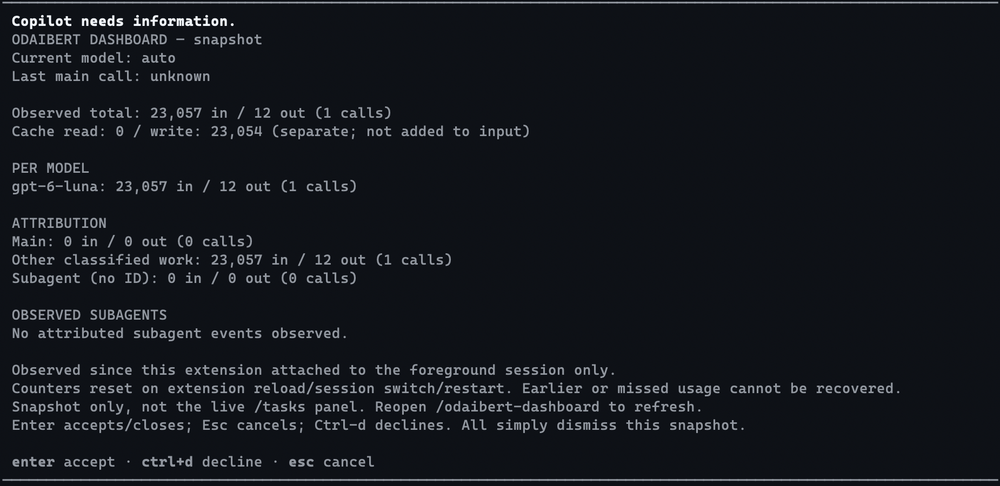
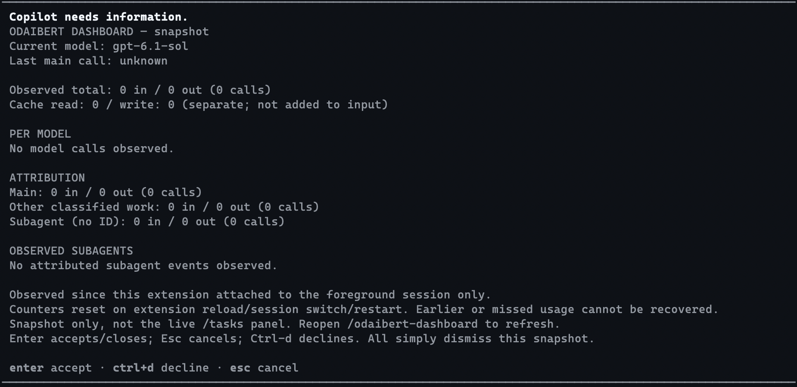

# Copilot panel example

A native Copilot CLI **snapshot dialog**, opened with **`/odaibert-dashboard`**.
No extra installations, dependencies, web UI, terminal renderer, or separate window.
This uses the built-in elicitation dialog, **not a custom/live `/tasks` panel**.
Reopen the command to refresh.

An educational example of registering a slash command, observing session events,
and displaying deterministic results through the host's native UI.
Follow the [implementation walkthrough](docs/IMPLEMENTATION.md) to learn how it works.

## Screenshots

Actual Copilot CLI 1.0.103 dialogs in Apple Terminal, cropped to the dashboard.
No mock data or reconstructed terminal rendering.

**After a real model request:** the selected model is `auto`, and the usage event
reports `gpt-6-luna` with 23,057 input and 12 output tokens. Attribution remains
conservative: this call appears under **Other classified work**, so **Last main
call** stays unknown. No subagents were run in this demo.



**Before any model request:** the dashboard already opens, but all usage totals
are zero. Opening the dashboard itself does not make a model request.



See [how these screenshots were captured](docs/IMPLEMENTATION.md#11-reproduce-the-screenshots)
for the exact demo steps and interpretation.

## Run

Requires existing Node.js 22+ and Copilot CLI with extension commands and native
elicitation support (verified against the installed SDK in CLI **1.0.103**).

```sh
git clone https://github.com/odaibert/copilot-panel-example.git
cd copilot-panel-example
copilot --plugin-dir "$PWD"
```

Then, inside Copilot:

```text
/odaibert-dashboard
```

Trust/enable the local plugin if Copilot asks. No `npm install` or global
configuration changes are needed. Alternatively, from this directory:

```sh
npm start
npm start -- --model auto
```

From any other working directory:

```sh
copilot --plugin-dir /absolute/path/to/copilot-panel-example --model auto
```

The launcher only runs `copilot --plugin-dir <this package>` with literal passthrough
arguments, preserving your working directory. `COPILOT_USAGE_COPILOT` optionally
selects another existing CLI executable. A published copy can also use Copilot's
normal GitHub/marketplace plugin installation, with the same `plugin.json` extension.
No launcher environment variables or runtime directory are required. Nothing is
auto-installed; the local directory can be loaded directly as shown above.

The dialog has no editable fields. In CLI 1.0.103, Enter accepts/closes, Esc cancels,
and Ctrl-d declines; all simply dismiss the snapshot. Unsupported native UI produces
a command error, not a silent fallback or model request.

## Accounting and scope

- **Current model** comes from `session.rpc.model.getCurrent().modelId` and live
  model-change events. Concurrent live changes win over stale snapshots. Unknown
  or unavailable model selection is explicit. **Last main call** is the last
  observed concrete main-agent model; subagent events never overwrite it.
- Input/output and per-model totals sum observed `assistant.usage` calls, ignoring
  duplicate event IDs. Cache read/write are shown separately, never added to input.
  Missing/invalid input or output contributes zero with an incomplete-count warning.
- Attribution uses `agentId`, with legacy `parentToolCallId` fallback. Classified
  subagent calls without IDs remain **Subagent (no ID)**. Other classified work is
  separate. Subagent lifecycle reported totals are displayed but never summed into
  per-call input/output or per-model totals.
- These are API-call token counts, not context occupancy, costs, credits, allowance,
  or lifetime session totals. Only events forwarded by the host can be counted;
  detached/remote/separate sessions are not automatically included.

Counters exist **in memory since this extension attached to the foreground session**.
They reset on extension reload, session switch, or restart, including resume.
Usage events are ephemeral: earlier calls and reload gaps cannot be recovered.
No journals, prompts, tool arguments/results, credentials, or transcripts are read
or stored. No metric files or network services are created. The command formats
observations directly; it does not ask a model to summarize them.

## Verification

```sh
npm test
npm run check
copilot --plugin-dir "$PWD" plugin list --json

COPILOT_USAGE_SDK_PATH=/absolute/path/to/copilot-sdk/extension.js \
  node --test test/sdk.test.mjs
```

Tests cover accounting, attribution, privacy, deduplication, model races, command
registration/dialog payloads, unsupported UI, and literal launcher arguments.
The optional SDK smoke test simulates a JSON-RPC host, executes the registered
command, and answers its UI request without model calls. It is not visual
verification of an interactive dialog.

API references: the installed SDK's `extension.d.ts`, `types.d.ts`,
`session.d.ts`, and `docs/extensions.md`. Uses `joinSession({ commands })`,
`session.on()`, `session.rpc.model.getCurrent()`, and `session.ui.elicitation()`.
The CLI 1.0.103 form renderer supports an empty object schema with dismissal keys.
If the command is absent, check `/env` and extension status and ensure this plugin
is trusted/enabled. The legacy manifest's `extensions` path field is intentional.
